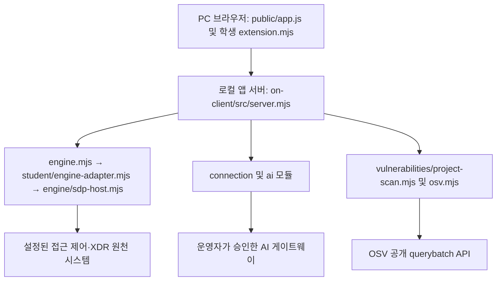

> **2026-10-28 최종 기준:** 이 문서는 단계별 이력을 보존합니다. 최신 과제 조건·실제 확인 결과·제출 위치는 [최종 제출·완성 기록](final-week/FINAL_SUBMISSION.md)을 우선합니다.

# 최부장님 학생 실행 설명서 — 21단계

작성 기준: 2026-10-23. 코드 기준: `fffd3bd111f067efc4929b625f1ed1171e3d298a`(20단계 구현). 이 문서와 함께 제출한 커밋에는 해당 코드와 문서가 모두 들어 있습니다. 21단계는 문서만 변경하며 화면·서버·인증 설정을 변경하지 않습니다.

## 1. 목적과 범위

최부장님은 현재 사용자·기기·세션, 업무 앱 접근 판정, 보안 기록과 근거, 참고용 AI 설명, 조치 요청 상태, 설치 패키지의 알려진 취약점 조회 결과를 구분해서 표시하는 학생 보안 Agent입니다. AI 설명은 해석이며 접속 판정·보안 조치 실행을 대신하지 않습니다.

저장소에는 이전 방어전의 Vercel 자료실과 13~22단계의 로컬 앱이 함께 있습니다. 이번 실행 대상은 **Git 최상위 폴더 아래 `on-client`**입니다. Vercel 배포 성공은 이 로컬 앱의 실행·AI 연결을 검증하지 않습니다. 서버 시작 로그의 기본 제품명은 `케셰브`이며 학생 Agent 이름 `최부장님`과 달라도 잘못된 실행이 아닙니다.

## 2. 필요한 프로그램과 지원 범위

| 항목 | 코드상 기준 | 이번 직접 확인 |
|---|---|---|
| Node.js | `on-client/package.json` engines: `24.19.0` | Linux에서 `v24.19.0` |
| npm | 로컬 앱의 start/demo/check 스크립트 실행 | `11.9.0` |
| Git | 저장소·커밋 확인, 원문 준비 | `2.51.1` 버전 확인 |
| Windows PowerShell | 제공 실행기 `on-client/tools/start-alekov.ps1` | 이번 환경에 없어 실행 미확인 |
| PC 브라우저 | `http://127.0.0.1:5189/` 접속 | 이번에는 HTTP 응답만 확인, 시각·키보드 검증 미실행 |
| native 계정 연결 | `src/connection/native-context.mjs`의 Windows 플랫폼 검사 및 운영자 설정 필요 | 실제 Windows 자격 저장소·운영 계정 연결 미확인 |
| 실제 SDP/AI/OSV | 운영자 설정·승인·권한과 원천 응답 필요 | 실제 운영 연결 미확인 |

루트 `package.json`은 Node `>=22`를 선언하지만 로컬 앱의 재현 기준은 24.19.0입니다. 제공 PowerShell 실행기는 22~24를 허용하나, 사용자의 이전 Node 22.11.0 실행에서 `node:sqlite` 오류가 보고되었습니다. 따라서 모든 Node 22 환경을 검증했다고 주장하지 않습니다. macOS 및 다른 Node 버전의 실행도 미확인입니다.

## 3. 작업 위치와 설치

기존 저장소가 있으면 그대로 사용합니다. 기존 폴더 위에 다시 복제하거나 `git reset --hard`로 초기화하지 않습니다. 새로 받는 사람만 비어 있는 상위 폴더에서 다음을 실행합니다. 비공개 저장소의 인증은 Git의 정상 로그인 경로를 사용하며 자격값을 명령에 넣지 않습니다.

```powershell
git clone https://github.com/SuperNova080710/choi-bujang-secret-vault.git
Set-Location .\choi-bujang-secret-vault
```

이미 저장소가 있다면 파일 탐색기에서 **README.md와 on-client 폴더가 함께 있는 Git 최상위 폴더**를 열고 새 PowerShell 창을 엽니다. 현재 폴더와 변경 상태를 확인합니다.

```powershell
Get-Location
git rev-parse --show-toplevel
git status --short
git rev-parse HEAD
node --version
npm --version
git --version
```

`git status --short`에 다른 작업이 보이면 내용을 먼저 확인하고 보존합니다. 이 문서를 따라 하기 위해 다른 작업을 삭제하거나 강제로 브랜치를 바꿀 필요는 없습니다. 아직 문서/구현 브랜치를 받지 않았다면 해당 PR의 병합 또는 브랜치 수령 상태부터 확인합니다.

```powershell
Set-Location .\on-client
Test-Path .\package.json
Test-Path .\src\server.mjs
Test-Path .\student\extension.mjs
npm run check
```

세 경로는 `True`, 문법 검사는 종료 코드 0이어야 합니다. 로컬 앱에는 외부 npm 의존성이 없으며 `npm install`이나 `npm ci`가 기본/demo 실행의 선행 조건이 아닙니다. 루트의 `package-lock.json`은 lockfileVersion 3이며 `@supabase/supabase-js` 2.117.2, `jose` 6.2.12를 포함하는 이전 자료실용 의존성입니다. 루트 기능 설치가 별도로 필요할 때만 루트에서 `npm ci`를 사용합니다. 이번 문서 작업에서는 해당 설치·Vercel 배포를 실행하지 않았습니다. 취약점 확인을 위해 패키지를 낮추거나 lock 파일을 바꾸지 않습니다.

## 4. 켜기·끄기·다시 켜기

### 기본 실행: 연결 없음도 정상적인 시작 상태

위에서 이동한 **on-client 폴더의 PowerShell**에서 실행합니다.

```powershell
powershell -NoProfile -ExecutionPolicy Bypass -File .\tools\start-alekov.ps1
```

제공 실행기가 폴더·Node·포트를 점검합니다. 실행 정책 옵션은 이 호출에만 적용됩니다. 기본 주소는 `http://127.0.0.1:5189/`입니다. 실행기에서 `케셰브가 켜졌습니다`와 주소를 안내하고, 서버는 `케셰브 연결 확인: http://127.0.0.1:5189`를 출력합니다. 이는 서버 응답 확인이며 실제 계정·SDP·AI 연결 성공이 아닙니다.

실행기 없이 같은 기본 서버를 켜는 명령은 다음입니다. **이미 실행 중인 서버와 동시에 실행하지 않습니다.**

```powershell
npm start
```

기본 설정에서 사용자·기록 조회의 `ENGINE_NOT_CONNECTED`는 실제 엔진이 연결되지 않았다는 뜻입니다. 오류를 빈 성공이나 정상 사용자로 바꾸지 않습니다.

### 예제 화면 실행

기본 서버를 종료한 다음 같은 폴더에서 실행합니다.

```powershell
npm run demo
```

또는 Windows 제공 실행기의 `-Demo` 옵션을 사용할 수 있습니다.

```powershell
powershell -NoProfile -ExecutionPolicy Bypass -File .\tools\start-alekov.ps1 -Demo
```

시작 신호는 `케셰브 예제: http://127.0.0.1:5189`입니다. 브라우저에 보호 현황·업무 앱·보안 기록 메뉴와 예제 자료(demo) 상태가 나타나야 합니다. 예제 엔진은 사용자·앱·사건을 제공하지만 실제 AI 자격, 조치 집행 또는 OSV 설정을 만들어 주지 않습니다. 설정 없는 demo에서도 설치 패키지 조회가 `not_configured`인 것이 정상입니다.

### 종료와 재실행

1. 실행한 터미널에서 `Ctrl+C`를 누르고 프롬프트가 돌아오는지 확인합니다.
2. 브라우저 새로고침 시 서버에 연결되지 않는지 확인합니다. 이미 그려진 화면만 남은 것은 실행 중이라는 증거가 아닙니다.
3. 같은 on-client 폴더에서 선택한 실행 명령을 다시 한 번 실행합니다.
4. 시작 로그의 주소로 접속하고 「다시 불러오기」를 눌러 현재 상태를 확인합니다.

`-Background`로 실행했다면 실행기가 알려 준 프로세스 번호의 node만 작업 관리자에서 확인 후 종료합니다. 다른 node 프로세스를 일괄 종료하지 않습니다. 포트 충돌 시 기존 작업을 종료할 필요 없이 다음처럼 다른 포트를 선택할 수 있습니다.

```powershell
powershell -NoProfile -ExecutionPolicy Bypass -File .\tools\start-alekov.ps1 -Port 5190 -Demo
```

이때 브라우저 주소도 `http://127.0.0.1:5190/`로 바뀝니다. 서버는 loopback에만 바인딩하며 다른 PC에서 접속하는 배포 환경은 이 절차의 지원 범위가 아닙니다.

## 5. 폴더와 구성도

아래 경로는 모두 Git 최상위 폴더 기준입니다.

| 경로 | 역할 |
|---|---|
| `README.md`, `docs/STUDENT_RUNBOOK.md` | 저장소 소개와 이번 학생 실행 설명서 |
| `package.json`, `package-lock.json`, `aleph.config.json` | 이전 자료실 스크립트·의존성·방어전 설정. aleph.config.json의 step 12는 기존 설정이며 현재 포털 진도를 나타내지 않음 |
| `public/`, `api/`, `src/`, `xdr/` | 이전 자료실, 접근 제어·XDR 작업. 이 로컬 앱의 정적 파일 폴더와 혼동하지 않음 |
| `on-client/package.json` | start/demo/check 및 Node 24.19.0 기준 |
| `on-client/tools/start-alekov.ps1` | 제공 Windows 실행기 |
| `on-client/public/index.html`, `on-client/public/app.js` | 제공 화면·요청·취소·응답 검증·학생 DOM 교체 |
| `on-client/student/extension.mjs` | 학생 화면 렌더링 |
| `on-client/student/engine-adapter.mjs` | 호스트가 전달한 본인 범위 기능을 연결하는 기존 어댑터 |
| `on-client/src/server.mjs`, `on-client/src/engine.mjs` | loopback HTTP API, 엔진 선택·demo·미연결 처리 |
| `on-client/src/engine/sdp-host.mjs`, `on-client/src/engine/sdp-host-config.mjs` | 설정된 SDP 호스트의 접근 판정·기록·기기·세션 조회 경로 |
| `on-client/src/connection/`, `on-client/src/ai/` | native 계정 연결, 앱 승인, AI 게이트웨이 요청·응답 검증 |
| `on-client/src/actions/` | 제공 조치 준비·전달·결과 확인 처리. 실제 운영 집행은 별도 미확인 |
| `on-client/src/vulnerabilities/` | 승인된 패키지의 설치 메타데이터·lock 대조와 OSV 조회 |
| `test/stage18-explanation.test.mjs`, `test/stage18-explanation-lifecycle.test.mjs`, `test/stage19-action.test.mjs`, `test/stage20-vulnerabilities.test.mjs` | 모의 DOM·요청 수명주기 회귀 테스트 |



브라우저는 같은 origin의 `/api/me`, `/api/apps`, `/api/events` 등으로 로컬 서버에 요청합니다. 업무 앱 접근 요청은 서버의 엔진 어댑터로 전달하고 원천 판정을 검증해 표시합니다. 기본 실행에는 원천 연결이 없고 demo에서는 `demoEngine()`의 예제 자료를 씁니다. `on-client`가 저장소의 이전 `xdr/` 스크립트를 자동 실행하는 구조는 아닙니다.

AI 요청은 로컬 서버의 연결·자격·사건 근거 검증을 거쳐 게이트웨이로 전달되는 별도 경로입니다. 학생 렌더 함수는 자격값을 받거나 원격 AI를 직접 호출하지 않습니다. 실제 게이트웨이 주소와 개인 자격 경로는 추측해 적지 않습니다.

패키지 조회는 `/api/vulnerabilities` → `createProjectScanner()` → 승인된 공개 이름/정확한 버전 → `https://api.osv.dev/v1/querybatch` 순서입니다. OSV 결과는 알려진 취약점 정보이며 침해 여부나 앱 전체 안전 판정이 아닙니다.

## 6. 학생 구현과 제공 기능의 경계

| 학생 함수 (`on-client/student/extension.mjs`) | 받는 입력·표시 책임 | 제공 코드가 담당하는 부분 |
|---|---|---|
| `renderIdentity` | me/devices/sessions의 사용자·기기·세션 및 확인 불가 | 조회·응답 검증 |
| `renderDecision` | status/mode/data/error/appId의 allow·deny·challenge 구분 | 실제 접근 판정 요청·원천 결과 |
| `renderEvents` | status/mode/data/error, 기록 필터·근거·규칙·상태 | 본인 범위 기록 조회·선택 |
| `renderStatus` | devices/sessions/notifications/diagnostics/mode | 상태·도움정보 조회 |
| `renderAiConnection` | status/mode/data/error/checkedAt/explanationAccepted | 계정 연결·앱 승인·모델 점검 |
| `renderExplanation` | event/explanation/checkedAt, 근거 연결과 참고용 요약 | 신원·근거 검증, AI 요청, 지연 응답 차단 |
| `renderAction` | status/event/actionId/target/receipt/observation/message/confirmationExpiresAt/error | 사람 확인·중복 방지·전송·결과 재조회 |
| `renderVulnerabilities` | status/mode/data/error, 버전·출처·시각·부분 결과 | lock/설치 대조·OSV 조회·응답 검증·취소 |

학생 함수는 DOM을 `createElement`·`textContent`로 작성합니다. `unknown`은 확인 불가, 조치 `pending`은 접수·처리 중, `succeeded`도 실제 효과 관측 증거를 확인해야 효과 확인으로 표시합니다. `none_found`와 미조회·실패는 다릅니다. 이번 21단계에서는 이 함수들과 제공 코드 모두 수정하지 않습니다.

## 7. 설정과 비밀 보관 경계

`on-client/.env.example`은 비밀 없는 견본입니다. 현재 npm start/demo와 실행기는 `.env`를 자동 로드하지 않습니다. 견본을 복사하는 것만으로 연결되지 않습니다. 루트 `.gitignore`는 `.env`, `.env.*`, `node_modules/` 등을 제외하지만 이미 추적된 파일의 비밀을 자동 제거하지는 않습니다.

| 설정/옵션 | 실제 소비 위치 | 학생 확인 범위 |
|---|---|---|
| `ON_PORT` / 실행기 `-Port` | server.mjs | 기본 5189, 유효 범위 1024~65535 |
| `ON_ENGINE_ADAPTER` | engine.mjs의 loadEngine | 실행자가 설정한 모듈. 기본값을 임의 변경하지 않음 |
| `-NativeHostConfig` → `--native-host-config` | connection/native-context.mjs | 운영자가 준비한 Windows 설정. 설정 내용은 출력하지 않음 |
| `-SdpHostConfig` → `--sdp-host-config` | engine/sdp-host-config.mjs | 운영자가 제공한 별도 개인 설정. demo와 동시 사용 불가 |
| `ON_PROJECT_DIRECTORY`, `ON_APPROVED_PUBLIC_PACKAGES` | vulnerabilities/project-scan.mjs | 운영자가 준비. 없으면 not_configured/not_checked 가능 |
| `ON_AI_MODEL` | AI 모듈 | 원격 허용 정책과 함께 검증하는 값. 임의 선택하거나 키 입력으로 연결을 우회하지 않음 |

키·토큰·비밀번호·개인 인증서는 코드·문서·화면 캡처·도움정보·커밋·제출 JSON에 적지 않습니다. 개인 호스트 설정과 자격 파일은 제공 계약에 따라 프로젝트 밖에 보관합니다. `.env` 사용 여부는 담당자의 승인된 경로를 따르며 native 설정을 `.env`로 대신하지 않습니다. 제공 실행기는 비밀로 보이는 환경변수를 자식 서버에 전달하지 않습니다.

운영자가 설정을 제공한 뒤에만 [native 연결 안내](../on-client/docs/AI_SETUP_GUIDE.md)와 [SDP 연결 안내](../on-client/docs/SDP_HOST_CONNECTION.md)를 참고합니다. 이번 작업에서 설정 발급·인증 변경·실제 집행 연결을 수행하지 않았습니다.

## 8. 오류별 확인과 복구

| 증상/코드 | 먼저 확인 | 복구 및 기대 결과 | 코드 근거 |
|---|---|---|---|
| `ERR_UNKNOWN_BUILTIN_MODULE: node:sqlite` | 실행 창의 `node --version` | Node 24.19.0을 선택하고 새 창에서 재실행. 성공을 추측하지 않고 시작 로그 확인 | src/actions/store.mjs의 sqlite import, package.json |
| `EADDRINUSE`, 실행기 포트 사용 안내 | 기존 서버가 같은 포트를 쓰는지 | 본인이 시작한 서버만 종료하거나 `-Port 5190`. 다른 작업 종료 금지 | server.mjs listen, start-alekov.ps1 |
| `Missing script`, 파일 없음 | 루트와 on-client를 혼동했는지 | `Set-Location .\on-client` 후 package.json 확인 | 두 package.json의 scripts |
| PowerShell에서 npm.ps1 실행 차단 | Node 설치와 정책 메시지 | 시스템 정책을 바꾸지 말고 `npm.cmd run demo` 또는 제공 실행기 사용. 이번 Windows 재현은 미확인 | npm 명령과 제공 실행기 |
| `ENGINE_NOT_CONNECTED` | 기본/demo/승인된 SDP 설정 구분 | 기본 미연결은 성공으로 바꾸지 않음. 예제 확인은 demo, 실제 연결은 담당자 설정 준비 후 | engine.mjs의 engineMethod |
| `NATIVE_HOST_DISABLED` | native 설정 제공 여부·Windows 환경 | 운영자에게 준비 상태 확인. 키를 요청하거나 학생이 설정을 만들어 대체하지 않음 | connection/native-context.mjs |
| `ON_AI_PROVISIONING_PENDING` | 계정 연결과 별도 AI 앱 승인 상태 | 담당자 권한 준비 후 「현재 API 연결 점검」. 유료 설명을 반복 호출하지 않음 | ai 및 public/app.js |
| `CONTRACT_MISMATCH`, `TIMEOUT` | 응답 형식·요청 시각·로컬 서버 실행 상태 | 「다시 불러오기」 또는 해당 수동 조회. 실패를 빈 성공으로 해석하지 않음 | public/app.js 검증·기한 처리 |
| `not_configured` | OSV 대상 프로젝트가 준비됐는지 | 운영자 설정 필요. 현재 결과는 미조회 | project-scan.mjs |
| `not_checked` | 승인된 공개 조회 대상 유무 | 허용 목록을 임의 확대하지 않음. 취약점 없음이 아님 | project-scan.mjs |
| `unverifiable`, `partial` | lock/설치 확인 또는 일부 조회 실패 | 받은 ID는 유지, 전체 결과는 확인 불가. 원인 확인 후 수동 재조회 | project-scan.mjs, osv.mjs |
| `CANCELLED`, 패키지 조회 취소 | 사용자가 취소했는지 | 이전 표·늦은 응답을 현재 결과로 표시하지 않음. 필요할 때 새 요청 | public/app.js cancelVulnerabilities |
| 조치 `unknown` | 관측된 처리 결과 유무 | 제공 버튼 「원천 결과만 재조회」 안내. 시험 삼아 재집행하지 않음 | public/index.html, renderAction |

추가 오류 안내는 [제공 장애 안내](../on-client/docs/CONNECTION_TROUBLESHOOT.md)를 참고합니다. 도움정보는 「도움정보 불러오기」로 읽고 안전한 코드·요청 시각만 확인합니다. 자동 전송이나 원문 자격 출력은 하지 않습니다. 「조치 화면 취소」는 이미 전달된 조치 효과를 되돌리지 않습니다.

## 9. 검증 기록과 아직 확인하지 않은 것

| 구분 | 결과와 한계 |
|---|---|
| 코드 대조 | 20단계 커밋의 on-client 전체 파일과 검증용 사본의 Git blob 해시 일치 확인 |
| 20단계 모의 검증 | 앞 작업에서 Node 24.19.0 문법 및 38/38 테스트 통과: 18단계 12, 19단계 13, 20단계 13. 실제 원격 성공을 뜻하지 않음 |
| 21단계 직접 실행 | Linux, Node 24.19.0/npm 11.9.0. on-client에서 npm start 및 npm run demo 실행. 루트 HTTP 200 확인 |
| 기본 실행 응답 | /api/me·/api/events는 503 ENGINE_NOT_CONNECTED, /api/vulnerabilities는 200 not_configured |
| demo 응답 | /api/me·/api/events는 200 예제 자료, /api/vulnerabilities는 200 not_configured |
| 종료·재실행 | SIGINT(Ctrl+C에 해당)로 본 검증 프로세스 종료, 포트 응답 중단 확인. demo 재실행 후 같은 응답 확인 |
| 학생 공식 판정 | 18·19단계 기존 통과 기록, 20단계는 2026-10-23 사용자 통과 보고. 20단계 전체 판정 HTML·정확한 접수 시각은 제공되지 않음 |
| Windows·화면 | 새 PowerShell 창에서 실행기 실행, 실제 브라우저 조작·시각·키보드 검증은 이번 작업에서 미실행 |
| 실제 연결 | 학생 계정 SDP·AI 설명·조치 효과·외부 OSV 조회와 실제 설치 버전 대조는 미확인. 제공 문서의 합성 환경 성공을 학생의 운영 성공으로 바꾸지 않음 |
| 21단계 판정 | 제출 전. 서버 AI의 원문 대조 판정이며 서버가 명령을 실행한 재현 검증이 아님 |

모의 검증 재실행은 Git 최상위 폴더에서 다음 명령으로 가능합니다. 외부 AI·조치·OSV 전송 없이 모의 데이터만 사용합니다.

```powershell
node --test test/stage18-explanation.test.mjs test/stage18-explanation-lifecycle.test.mjs test/stage19-action.test.mjs test/stage20-vulnerabilities.test.mjs
```

사용자 직접 확인은 한 번에 하나씩 진행합니다. **첫 확인:** 새 PowerShell 창에서 3~4절을 따라 demo를 켜고 주소·예제 상태를 확인합니다. 그 결과를 남긴 뒤 다음으로 버튼·표시를 대조합니다. 보호 현황의 「설치 패키지 조회」와 「패키지 조회 취소」, 상단 「다시 불러오기」는 실제 버튼 이름입니다. 제공 결과와 학생 칸이 같은 상태·버전·시각을 표시해야 하며 미조회/실패가 취약점 없음으로 바뀌어서는 안 됩니다.

## 10. 21단계 커밋과 원문 제출

이번 공식 과제 화면이 제공 문서의 옛 제출 안내보다 우선합니다. 현재 워크벤치 「포털 제출 준비」는 13~20단계 지원이며 21·22단계는 과제 화면에 저장소 주소와 **40자리 커밋**을 직접 입력합니다. 제공 STUDENT_LAUNCH_GUIDE.md의 “21·22단계 미확정” 및 AI_SETUP_GUIDE.md의 “start/demo/test” 문구는 옛 안내입니다. 실제 on-client 스크립트는 start/demo/check입니다.

1. 사용자 병합 전에도 PR의 제출 후보 커밋은 코드·문서가 함께 들어 있는 스냅샷입니다. 병합은 사용자가 직접 합니다. 병합 후 제출한다면 실제 사용할 커밋을 다시 확인합니다.
2. Git 최상위 폴더에서 `git status --short`, `git diff --cached --stat`, `git rev-parse HEAD`로 변경과 제출 커밋을 확인합니다. 다른 작업을 일괄 stage하거나 덮어쓰지 않습니다.
3. 비공개 커밋이면 과제 화면의 「원문 전달 도구 받기」 ZIP을 프로젝트 밖에 풀고, JSON 출력 폴더도 프로젝트 밖에 만듭니다. 저장소를 공개로 바꿀 필요는 없습니다.
4. 같은 Git 최상위 폴더의 PowerShell에서 과제 화면 명령을 사용하되 도구 경로·출력 경로는 본인 PC의 실제 경로, `--commit`은 제출할 40자리 값으로 지정합니다. 실제 Windows 경로를 확인하지 않았으므로 이 문서에 임의의 실행용 절대 경로를 확정하지 않습니다. 명령 형식은 `node <student-source-cli.mjs의 실제 경로> --output <프로젝트 밖 JSON 경로> --commit <확인한 40자리 커밋>`입니다. 공백이 있는 경로는 큰따옴표로 감쌉니다.
5. 도구는 커밋된 원문만 묶고 학생 코드를 실행하거나 업로드하지 않습니다. 생성 JSON을 21단계 원문 묶음에 선택하고 동일 저장소·커밋을 확인해 사용자가 제출합니다.
6. 원문 전달 완료와 공식 통과는 다릅니다. 전달만 실패하면 기존 접수를 유지하고 「원문만 다시 보내기」를 사용합니다. 제출 후 서버 상태와 「AI 판정 설명 보기」를 확인합니다. 이 버튼은 학생 앱의 AI 설명 요청 버튼이 아닙니다.

이 문서 작성 중 실제 유료 AI 요청·보안 조치·단계 제출·사용자 브랜치 병합은 실행하지 않았습니다.
